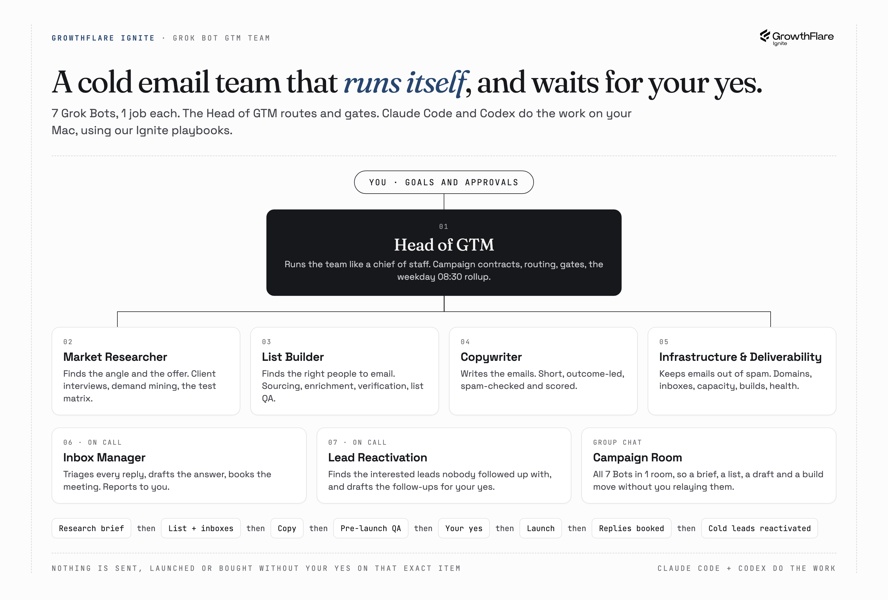

# Grok Bot GTM team

**7 Grok Bot agents that run cold email campaigns for your clients, the rules they work by, and the playbooks from our Ignite trainings that Claude Code and Codex follow to do the real work.**

[](assets/org-chart.png)

Running cold email for clients is 6 jobs: find the angle and the offer, find the right people, write the emails, keep them out of spam, work the replies until a meeting is booked, and go back for the interested leads who never booked. This repo turns those jobs into a team. Every Bot has 1 job. The Head of GTM runs the team like a chief of staff: it writes the campaign contract, routes the work, gates every step and sends you one rollup each morning. Anything that needs producing goes to Claude Code or Codex on your Mac, using the playbooks in this repo. You approve.

**[Import the team in 1 prompt](setup-prompt.md)** · [The 7 Bots](#the-team) · [The playbooks](#the-playbooks) · [The rules](guides/rules.md) · [Claude Code and Codex](guides/claude-code-and-codex.md)

## Import the team

1. Clone this repo to `~/repos/grokbot-gtm-team` on your Mac.
2. Create a new Bot in Grok Bot, call it **Head of GTM**, and give it local execution on your Mac.
3. Paste the prompt from **[setup-prompt.md](setup-prompt.md)** into its chat.
4. Answer its 5 questions (your agency, your clients, your tools, your time zone, which Bots you want). It creates the other Bots, the Campaign Room and the 1 routine, then tells you what's left to do in the app.
5. Copy `.env.example` to `.env` and fill in the keys for the tools you use. Grok Bot never sees them.

Nothing is sent or spent during setup. Prefer to do it by hand? Every file in [agents/](agents/) has the instructions block to paste.

## The team

| Bot | Job | Reports to |
|---|---|---|
| [Head of GTM](agents/01-head-of-gtm.md) | Runs the team like a chief of staff: campaign contracts, routing, gates, the weekday 08:30 rollup, every handoff to Claude Code or Codex | You |
| **Campaign** | | |
| [Market Researcher](agents/02-market-researcher.md) | Finds the angle and the offer: client interviews, demand mining, the test matrix | Head of GTM |
| [List Builder](agents/03-list-builder.md) | Finds the right people to email: sourcing, enrichment, verification, list QA | Head of GTM |
| [Copywriter](agents/04-copywriter.md) | Writes the emails: sequences, variants, spam check, QA score | Head of GTM |
| [Infrastructure & Deliverability](agents/05-infrastructure-deliverability.md) | Keeps the emails out of spam: domains, inboxes, capacity, campaign builds, health | Head of GTM |
| **On call** | | |
| [Inbox Manager](agents/06-inbox-manager.md) | Triages replies, drafts answers, books the meetings | You |
| [Lead Reactivation](agents/07-lead-reactivation.md) | Finds the interested leads nobody followed up with, drafts the follow-ups | You |
| [Campaign Room](agents/08-campaign-room.md) | The group chat where the Bots hand work to each other | |

## How a campaign flows

```text
You                 approve the contract, the angle, the copy and the launch
  ↓
Head of GTM         writes the campaign contract, routes and gates every step
  ↓
Market Researcher   research brief: validated pains, the offer, the test matrix
  ↓
List Builder        +   Infrastructure & Deliverability
the verified list       enough warmed inboxes for the list
  ↓
Copywriter          the sequences, spam-checked and scored
  ↓
Pre-launch QA       list + copy + build, then your yes, then launch
  ↓
Inbox Manager       every reply triaged, interested leads booked
  ↓
Lead Reactivation   interested leads who went cold, found and followed up
  ↓
Head of GTM         the morning rollup: numbers, blockers, decisions for you
```

## How the work gets done

```text
You           goals and approvals
  ↓
Grok Bot      7 Bots and 1 group chat; the Head of GTM routes the work
  ↓
Claude Code   any Bot can send it a unit of work: outcome, inputs, playbook,
+ Codex       limits, client and campaign code
  ↓
Your Mac      this repo's playbooks, your clients/ folder, your keys, your
              sending platform and data tools; every result comes back for review
```

The details are in **[guides/claude-code-and-codex.md](guides/claude-code-and-codex.md)**: the 5-part handoff, persistent terminal sessions, 1 worktree per task, and how data gets read without giving Grok Bot your keys.

## The playbooks

Our Ignite trainings, written as the rules Claude Code follows. Every Bot points at the ones for its job.

| Playbook | What's in it | Used by |
|---|---|---|
| [opinions.md](playbooks/opinions.md) | What we believe about outbound: targeting, offers, copy, personalization, sending. Sits over every other playbook. | Every Bot |
| [market-research.md](playbooks/market-research.md) | Client interviews, demand mining, persona research, the test matrix, the research brief | Market Researcher |
| [offers.md](playbooks/offers.md) | Our offer frameworks: the strong-offer test, free deliverables, offer types, value props | Market Researcher, Copywriter |
| [lists.md](playbooks/lists.md) | Sourcing methods, the enrichment waterfall, verification, dedupe, list QA | List Builder |
| [copy.md](playbooks/copy.md) | Our copy frameworks: the default skeleton, subject lines, CTAs, follow-ups, testing, QA | Copywriter |
| [taste.md](playbooks/taste.md) | What good looks like, and the reject-on-sight test | Copywriter, Inbox Manager |
| [infrastructure.md](playbooks/infrastructure.md) | Domains, inboxes, DNS, warmup, capacity, campaign settings, the deliverability rulebook | Infrastructure & Deliverability |
| [inbox.md](playbooks/inbox.md) | Reply triage, drafting, booking, objections, the daily inbox report | Inbox Manager |
| [reactivation.md](playbooks/reactivation.md) | Finding interested leads nobody followed up with, the report, the follow-up drafts | Lead Reactivation |

`opinions.md` and `taste.md` are GrowthFlare's defaults. Make them yours: change a rule there, and every Bot follows the new one.

## Starter skills

Ignite repos the Bots already know how to use. Clone the ones you want next to this repo.

| Skill | Used by |
|---|---|
| [demand-miner](https://github.com/growthflare-ignite/demand-miner) | Market Researcher |
| [spam-check](https://github.com/growthflare-ignite/spam-check) | Copywriter, List Builder |
| [inbox-ai-manager](https://github.com/growthflare-ignite/inbox-ai-manager) | Inbox Manager, Lead Reactivation |
| [lead-magnet-skill](https://github.com/growthflare-ignite/lead-magnet-skill) | Market Researcher, when the offer is a lead magnet |

## Design choices

- **The Head of GTM runs the team, it doesn't do the work.** One Bot that plans and gates, 6 that each own one job. Every result gets checked by someone other than its maker.
- **Nothing goes out without your yes.** Drafts are the default. Sending, launching, uploading and buying all wait for your yes on that exact item.
- **One routine.** The Head of GTM's rollup every weekday at 08:30. A routine earns its place only if you read it every time.
- **One data connector in Grok Bot.** Grok Bot can't restrict connectors per Bot, so only Lead Reactivation connects to EmailBison, to read the reply threads it works through. Your inbox provider and lead data tools stay on your Mac, where Claude Code reads them with your keys.
- **Client data never leaves your Mac.** `clients/` is ignored by git, so a pull or a push never carries a client's files.

## What you need

- A Grok Bot account.
- A Mac, with Claude Code or Codex logged in. Without them, delete the handoff line from a Bot's instructions and paste in the playbook it needs, and it does the work itself.
- A sending platform and an inbox provider (our trainings use EmailBison and InboxKit or Premium Inboxes).
- Lead data and verification tools (our trainings use QuickEnrich, AI-Ark, Prospeo and MillionVerifier).

## Credit

The team structure follows Tim Scheuer's public [grokbot-gtm-team](https://github.com/timscheuerai/grokbot-gtm-team). The roles, rules and playbooks are GrowthFlare Ignite's, for Ignite students only. Don't share this repo outside the program.
